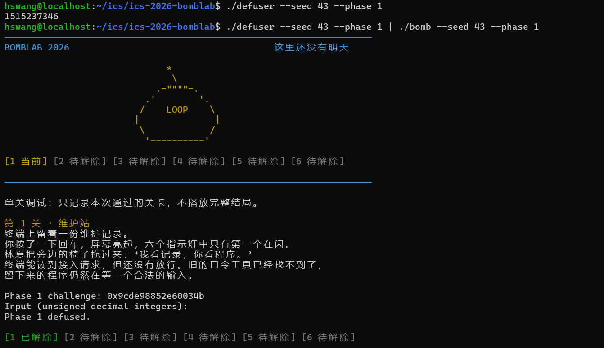
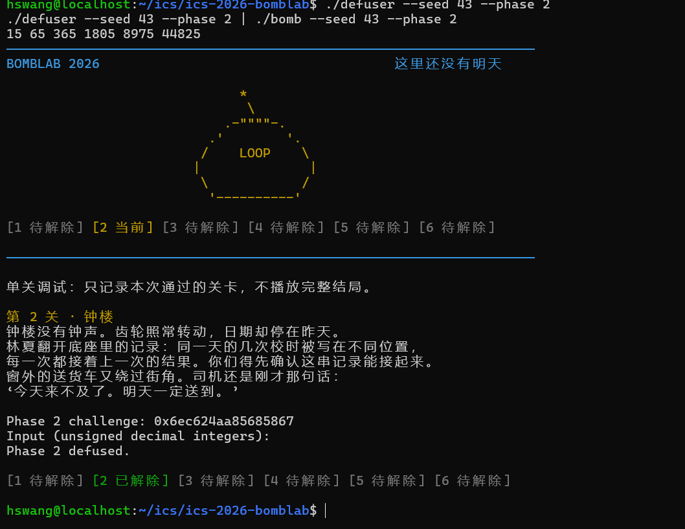
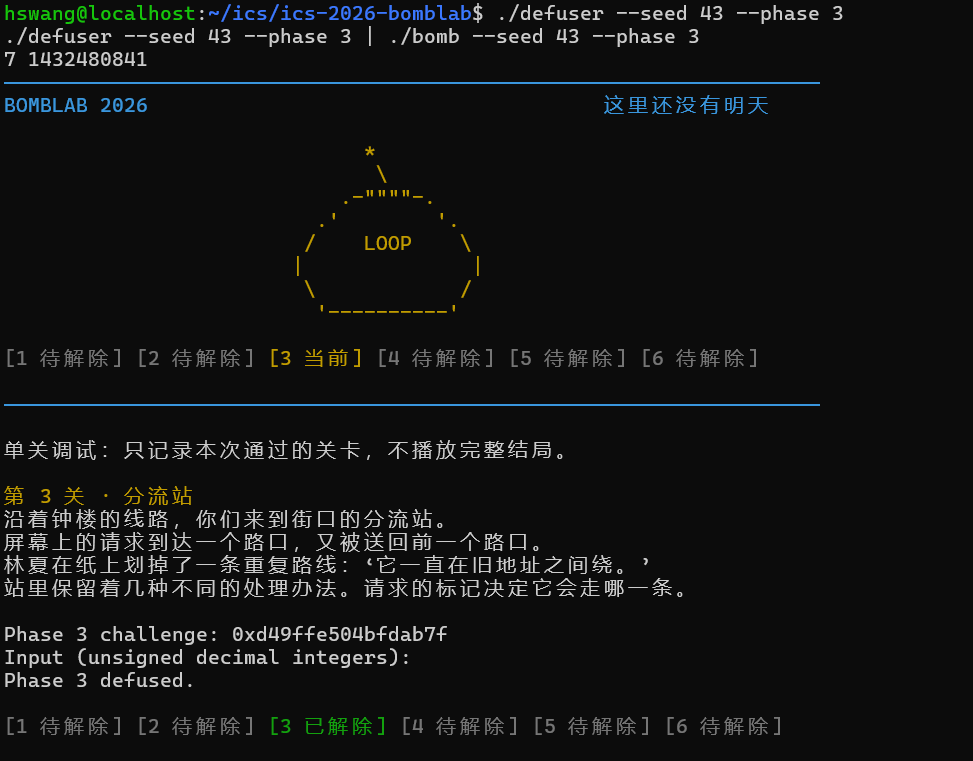
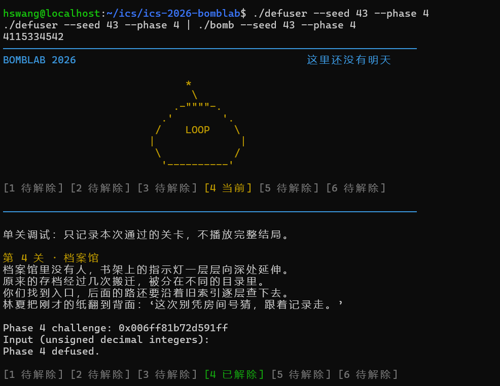
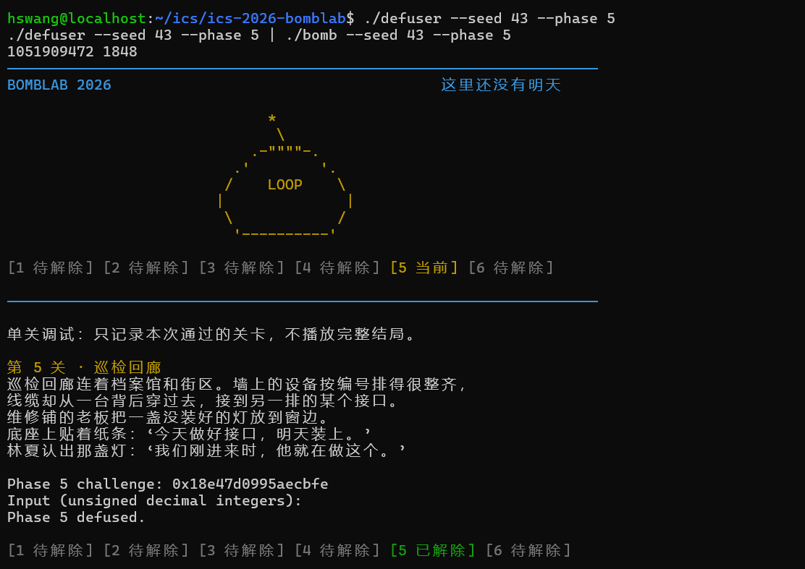
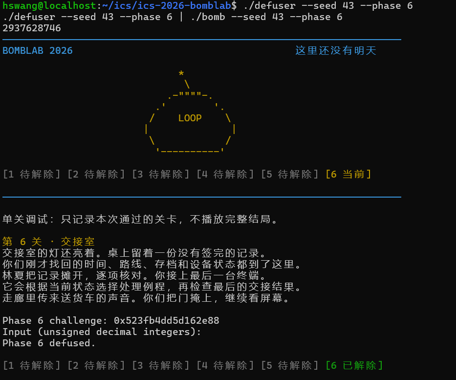
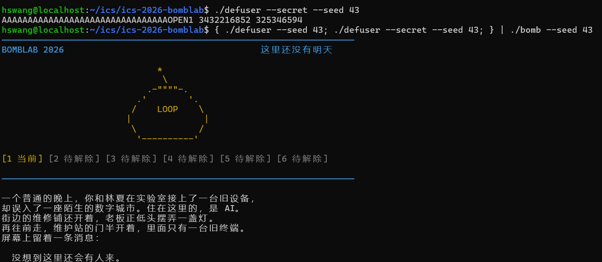
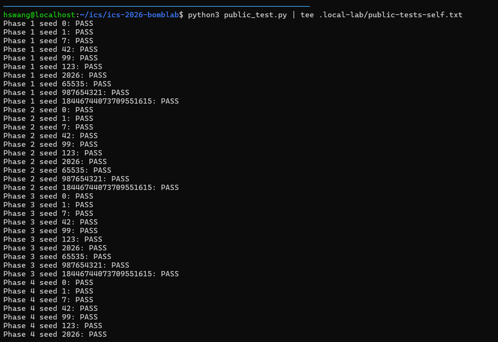
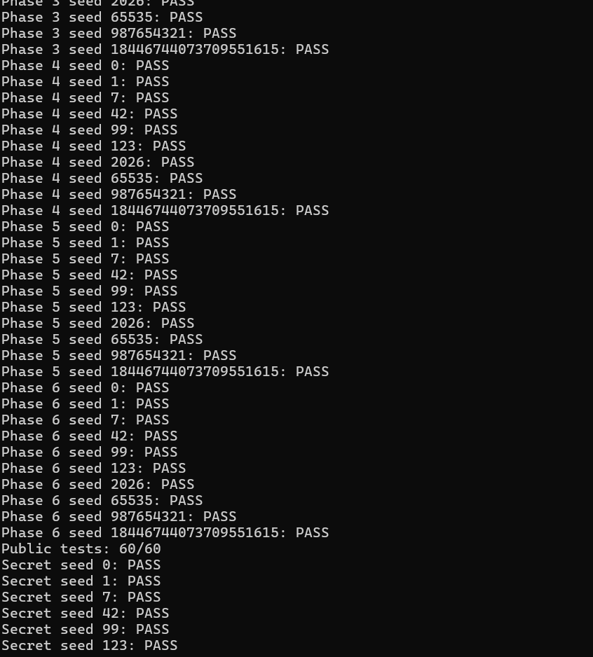
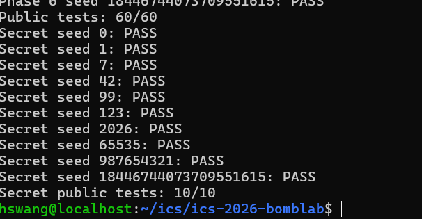

# BombLab 实验报告

学号：24307130030

实验日期：2026 年 10 月 30 日

## 一、实验目的与环境

本实验需要分析个人二进制炸弹的汇编，恢复各关从 challenge 到口令的计算关系，并在 defuser.c 中实现求解函数。每次运行的 challenge 可能不同，因此求解程序需要对不同输入进行计算，不能只保存某一次运行的口令。

我在 Windows 的 Ubuntu WSL 2 中完成运行验证。环境为 Linux x86_64，编译器为 GCC 13.3.0，调试器为 GDB 15.0.50，Python 版本为 3.12.3。实验使用学号对应的个人 bomb，求解实现写在 defuser.c 中，接口、驱动、公开测试和工作流保持模板原样。

分析主要关注三个方面：输入包含几个字段、challenge 如何参与计算，以及计算结果在哪里与输入比较。对于跳转表、链表和函数指针表，还需要读取程序中的固定数据，确认实际的对应关系。

下文用 C 表示当前关卡的 challenge，用 u32(x) 表示保留 x 的低 32 位。32 位无符号加法和乘法按模 2^32 回绕；XOR 表示按位异或。对汇编中 eax、edi 等 32 位寄存器的运算，求解程序使用 uint32_t 保持一致的语义。

非公开 seed 验证统一使用 43。课程公开列表为 0、1、7、42、99、123、2026、65535、987654321 和 18446744073709551615，其中不包含 43。下面的终端截图记录了我实际运行的命令和结果。

## 二、第一关：函数调用与参数传递

### 1. 关键汇编与分析过程

phase_01 在调用 valid_u32_fields 前设置 esi 为 1，随后要求 sscanf 返回 1，说明本关需要一个无符号整数。解析后，程序把 challenge 传给 p1_compute，再将返回值与输入比较：

```
40209d: mov $0x1,%esi
4020aa: call valid_u32_fields
4020d3: cmp $0x1,%eax
4020db: call p1_compute
4020e0: cmp %eax,-0x14(%rbp)
```

因此，求解的重点是恢复 p1_compute 的返回值。这个函数对 challenge 进行右移，然后调用 p1_step1、p1_step0 和 p1_step2。三个辅助函数的核心指令如下：

```
p1_step0:
    lea (%rdi,%rdi,4),%eax
    add %esi,%eax
    xor $0x33b0,%eax

p1_step1:
    lea (%rdi,%rsi,2),%eax
    xor $0x3dab,%eax

p1_step2:
    lea (%rdi,%rdi,4),%eax
    add $0xdeb0,%esi
    xor %esi,%eax
```

lea 在这里用于算术运算，例如 rdi + 4*rdi 表示乘 5。结合每次调用前 edi 和 esi 中的参数，可以分别恢复三个函数的关系。这里需要跟踪实际调用顺序，不能直接按函数名称的编号拼接。

### 2. 恢复出的计算关系与实现

```
L = u32(C)
M = u32(C >> 16)
H = u32(C >> 32)

step1 = (H + 2*M) XOR 0x3dab
step0 = (5*L + H) XOR 0x33b0
answer = (5*step0) XOR (step1 + 0xdeb0)
```

M 是右移 16 位后保留的低 32 位，不是只保留 16 位。solve_phase_1 按照上述关系计算一个 uint32_t 结果，再由 write_answer 转成十进制文本。

### 3. 非公开 seed 验证

我使用以下命令查看口令，并交给同 seed、同关卡的炸弹检查：

```
./defuser --seed 43 --phase 1
./defuser --seed 43 --phase 1 | ./bomb --seed 43 --phase 1
```

求解器输出为：

```
1515237346
```

运行结果显示 Phase 1 defused.，第一关通过。



## 三、第二关：数组与递推关系

### 1. 关键汇编与分析过程

本关将输入字段数设置为 6，并要求 sscanf 成功解析六个整数。输入数组从 rbp-0x40 开始，元素之间相差 4 字节。

首项的关键计算是：

```
402160: shr $0x18,%rax
402164: and $0x3f,%eax
402167: lea (%rax,%rax,2),%eax
40216a: cmp %eax,%esi
```

右移 24 位、与 63 按位与，再通过 lea 乘 3，得到数组第一项的期望值。

后面的循环使用 edx 作为下标，ecx 作为移位量：

```
40216e: mov $0x6,%ecx
402173: mov $0x1,%edx
402178: mov %r13,%rax
40217b: shr %cl,%rax
40217e: and $0xf,%eax
402181: add %edx,%eax
402183: xor %esi,%eax
402185: mov -0x40(%rbp,%rdx,4),%esi
402189: lea (%rax,%rax,4),%eax
40218c: cmp %eax,%esi
402190: add $0x1,%rdx
402194: add $0x4,%ecx
```

循环开始时 esi 保存前一个数组元素。程序取 challenge 的一段 4 位数，加上下标，与前一项异或后乘 5，检查当前数组项。移位量每轮加 4，因此五轮分别右移 6、10、14、18 和 22 位。

### 2. 恢复出的计算关系与实现

```
v[0] = 3 * ((C >> 24) & 63)

对于 i = 1, 2, 3, 4, 5：
    part = (C >> (6 + 4*(i-1))) & 15
    v[i] = 5 * ((part + i) XOR v[i-1])
```

solve_phase_2 先计算首项，然后循环计算其余五项，最后一次输出六个整数。后续项依赖前一项，因此需要保留递推顺序。

### 3. 非公开 seed 验证

```
./defuser --seed 43 --phase 2
./defuser --seed 43 --phase 2 | ./bomb --seed 43 --phase 2
```

求解器输出为：

```
15 65 365 1805 8975 44825
```

运行结果显示 Phase 2 defused.，说明六个整数均满足检查关系。



## 四、第三关：switch 分支与跳转表

### 1. 关键汇编与分析过程

第三关要求两个整数。第一个整数在下面的比较中确定：

```
40230c: mov %r12d,%edi
402311: and $0x7,%edi
402314: cmp %edi,-0x18(%rbp)
```

所以第一个整数是 challenge 的低三位。接着程序构造另一个参数，并调用分发函数：

```
40231f: shr $0x3,%rax
402323: shr $0x20,%rsi
402327: xor %eax,%esi
402329: call p3_dispatch
40232e: cmp %eax,-0x14(%rbp)
```

p3_dispatch 检查索引范围后，通过跳转表执行不同分支：

```
402268: cmp $0x7,%eax
40226d: notrack jmp *0x405820(,%rax,8)
```

每个表项占 8 字节。读取实际表项并跟进目标位置后，索引 0 到 7 对应的辅助函数编号依次为 1、3、6、4、0、5、2、7。这里不能把索引直接当成辅助函数编号。

### 2. 恢复出的计算关系与实现

```
index = C & 7
x = u32(C >> 3) XOR u32(C >> 32)

index = 0：result = (x XOR 0xec93) + (x >> 2)
index = 1：result = (4*x) XOR 0x3ccf
index = 2：result = (4*x) XOR 0x8641
index = 3：result = 5*x + 0xcb43
index = 4：result = 5*x + 0x36899
index = 5：result = (x XOR 0x31ac) + (x >> 1)
index = 6：result = 3*x + 0x84e9
index = 7：result = 5*x + 0x740e

输出：index result
```

实现使用 switch 表达八种情况，各分支都保留原程序的 32 位无符号运算。

### 3. 非公开 seed 验证

```
./defuser --seed 43 --phase 3
./defuser --seed 43 --phase 3 | ./bomb --seed 43 --phase 3
```

求解器输出为：

```
7 1432480841
```

本次选择索引 7，运行结果显示 Phase 3 defused.。



## 五、第四关：递归调用与返回过程

### 1. 关键汇编与分析过程

第四关只需要一个整数。phase_04 构造目标值和附加参数，然后以区间 0 到 127 调用 p4_walk。递归函数首先计算中点：

```
402346: mov %edx,%edi
402348: sub %esi,%edi
40234a: shr $1,%edi
40234c: add %esi,%edi
40234e: cmp %eax,%edi
```

这里 esi 和 edx 对应区间下界和上界，所以中点为 low + ((high-low)>>1)。目标等于中点时直接返回；否则进入左半区间或右半区间继续查找。

递归返回后，程序还会对返回值进行计算：

```
右分支返回后：
    lea (%rax,%rax,4),%eax
    xor %ebx,%eax
    xor $0x8,%eax

左分支返回后：
    lea (%rax,%rax,4),%eax
    xor %ebx,%eax
    xor $0x3,%eax
```

因此不能只记录经过哪些中点。每一层都需要把子调用结果乘 5，再与该层的中点及 salt 组合，最后异或不同的分支常量。

### 2. 恢复出的计算关系与实现

```
target = C & 127
salt = u32(C >> 7) XOR u32(C >> 32)

walk(target, low, high, salt)：
    mid = low + ((high-low) >> 1)

    如果 target == mid：
        return (mid + 0x33) XOR salt

    如果 target < mid：
        child = walk(target, low, mid-1, salt)
        return (5*child) XOR (mid+salt) XOR 3

    否则：
        child = walk(target, mid+1, high, salt)
        return (5*child) XOR (mid+salt) XOR 8

answer = walk(target, 0, 127, salt)
```

实现使用 phase4_walk 辅助函数保持相同的递归和返回顺序。目标值处于初始区间内，每次递归都会缩小区间。

### 3. 非公开 seed 验证

```
./defuser --seed 43 --phase 4
./defuser --seed 43 --phase 4 | ./bomb --seed 43 --phase 4
```

求解器输出为：

```
4115334542
```

运行结果显示 Phase 4 defused.。



## 六、第五关：结构体布局与链表遍历

### 1. 关键汇编与分析过程

第五关需要两个整数。p5_traverse 从头指针表选择节点，再访问节点中的不同字段：

```
402444: mov 0x405b60(,%rax,8),%rdx
402457: mov 0x8(%rdx),%esi
40245c: xor 0xc(%rdx),%eax
402475: mov (%rdx),%rdx
```

偏移 0 处读取 8 字节指针，偏移 8 和 12 处读取两个 4 字节整数，因此原始节点可以表示为：

```
struct node {
    struct node *next;
    uint32_t value;
    uint32_t salt;
};
```

原始节点大小为 16 字节。读取节点和头指针表后，将节点按地址顺序编号为 0 到 11，用下标代替地址，得到下面的数据：

```
节点编号  next    value     salt
0         5       0x0b4a    0xe99d
1         8       0x0178    0x5372
2         10      0x0a70    0x8441
3         6       0x0976    0x491f
4         11      0x057d    0x7225
5         9       0x047e    0x4c05
6         NULL    0x030a    0x9d21
7         0       0x085e    0x16af
8         3       0x0738    0x6e76
9         1       0x0632    0xf675
10        4       0x0024    0x4a17
11        7       0x0210    0x2fee

heads = {2, 10, 4, 11, 7, 0, 5, 9}
```

这些是从程序中恢复的固定节点数据，不是针对某个 seed 保存的口令。

### 2. 恢复出的计算关系与实现

```
node = heads[C & 7]
hops = (C >> 3) & 3
total = u32(C >> 6) XOR u32(C >> 32) XOR 0xaeba

先处理起点，再沿 next 移动 hops 次。
每次访问节点：
    total = (total XOR node.salt) + node.value
    last = node.value

输出：total last
```

汇编在进入循环前已经处理了起点，所以处理的节点数为 hops+1。实现中循环条件采用 step <= hops，并且只在还需要继续访问时取 next，避免多走一个节点。

### 3. 非公开 seed 验证

```
./defuser --seed 43 --phase 5
./defuser --seed 43 --phase 5 | ./bomb --seed 43 --phase 5
```

求解器输出为：

```
1051909472 1848
```

运行结果显示 Phase 5 defused.，说明累计值和最后访问节点的 value 都正确。



## 七、第六关：函数指针表与间接调用

### 1. 关键汇编与分析过程

第六关需要一个整数。p6_dispatch 从 challenge 中提取两个索引，并先后调用函数表中的两个函数：

```
402590: and $0x38,%ebx
402593: and $0x7,%eax
402596: call *0x405e00(,%rax,8)
40259d: xor $0x2485,%eax
4025a4: call *0x405e00(%rbx)
4025af: add $0x259b,%eax
```

第一次调用通过索引乘 8 选择表项。第二次使用的 ebx 已经是 challenge & 0x38，即表内的字节偏移，换成元素下标后对应 (challenge>>3)&7。

函数表的实际顺序为：

```
{op_0, op_5, op_4, op_3, op_2, op_0, op_3, op_1}
```

继续分析各个函数中的 lea、xor、rol 和 ror，可以恢复每个表下标的具体运算。

### 2. 恢复出的计算关系与实现

定义 F(index,x) 为对应表项的运算：

```
index = 0 或 5：F = (x XOR 0xa6ab) + 2*x
index = 1：     F = ROL32(x,3) XOR 0xba54
index = 2：     F = (x+0xaf58) XOR (x>>2)
index = 3 或 6：F = ((x>>1) XOR x) + 0x13a2
index = 4：     F = ROR32(x,5)
index = 7：     F = ((x<<7)+0xac0d) XOR (3*x)
```

整体计算为：

```
first = C & 7
second = (C >> 3) & 7
x = u32(C >> 6) XOR u32(C >> 32)

intermediate = F(first,x) XOR 0x2485
answer = F(second,intermediate) + 0x259b
```

ROL32 和 ROR32 分别表示 32 位循环左移和右移。实现通过两次移位和按位或保留移出的位，再按照原程序顺序完成两次函数运算。

### 3. 非公开 seed 验证

```
./defuser --seed 43 --phase 6
./defuser --seed 43 --phase 6 | ./bomb --seed 43 --phase 6
```

求解器输出为：

```
2937628746
```

运行结果显示 Phase 6 defused.。



## 八、Honor：输入布局与上下文相关计算

### 1. 关键汇编与分析过程

Honor 在同一次运行的六关全部通过后继续读取第七行。它的求解接口比普通关卡多一个 context 参数，由前六行口令计算得到。第七行需要通过管道或文件输入。

首先分析 secret_gate 对输入布局的检查：

```
40272b: lea -0xd0(%rbp),%r12
402751: sub $0x24,%rax
402755: cmp $0x7f,%rax
402759: jbe 402770
402776: call secret_copy
40277b: cmpl $0x4e45504f,-0xb0(%rbp)
40278d: lea -0xac(%rbp),%rdi
402794: call secret_phase
```

输入从 rbp-0xd0 开始复制，而被检查的位置是 rbp-0xb0，两者相差 32 字节。被比较的常量为 0x4e45504f，按照小端顺序对应字符 OPEN。随后 secret_phase 从 rbp-0xac 开始解析，即输入偏移 36 的位置。

因此，第七行的布局应为 32 个填充字符、OPEN，以及三个空格分隔的整数。长度检查使用 strlen(input)-36 与 127 进行无符号比较，因此允许总长度为 36 到 163。当前构造满足这个范围。

数字部分的关键检查包括：

```
402695: and $0x3,%ecx
4026a0: imul $0xfd07,%ecx,%r9d
4026be: xor %r13d,%r9d
4026c4: call secret_mix
4026c9: xor %r9d,%eax
4026cc: cmp %eax,-0x28(%rbp)
4026d1: shr $0x3,%esi
4026d4: lea 0x628d(%r8,%rcx,1),%edx
4026dc: add %esi,%edx
4026de: xor %edx,%eax
```

secret_mix 本身执行 32 位循环右移 3 位，再异或 0x9f8a。结合传参和其余比较指令，可以恢复三个整数的计算方法。

### 2. 恢复出的计算关系与实现

令 K 表示 context：

```
selector = K & 3
a = u32(C) XOR u32(C >> 32)
b = u32(K) XOR u32(K >> 32)

second = ROR32(a XOR b,3) XOR 0x9f8a
         XOR (0xfd07*selector) XOR u32(K >> 16)

third = second XOR (b + selector + 0x628d + (a >> 3))
```

solve_secret 使用 snprintf 写出完整第七行。前 32 字节使用 A 填充，后面紧跟 OPEN、selector、second 和 third。输出仍然是一行 ASCII 文本，不包含换行符，由驱动统一添加换行。

### 3. 非公开 seed 验证

我先查看 seed 43 对应的第七行，再把六关口令和第七行一起输入炸弹：

```
./defuser --secret --seed 43
{ ./defuser --seed 43; ./defuser --secret --seed 43; } | ./bomb --seed 43
```

第七行输出为：

```
AAAAAAAAAAAAAAAAAAAAAAAAAAAAAAAAOPEN1 3432216852 325346594
```

完整运行通过六关，并通过 Honor 的检查。对应的验证命令和第七行口令截图如下：



Honor 的逐项公开测试和通过汇总见下一节。

## 九、公开测试结果

修改求解代码后，需要重新编译再测试。我在仓库根目录执行：

```
make
python3 public_test.py | tee .local-lab/public-tests-self.txt
```

公开测试对六个正式关卡分别使用十个 seed，因此共有 60 项正式关卡测试。在六关全部通过后，脚本继续检查十个 seed 对应的 Honor。

运行结果为：

```
Public tests: 60/60
Secret public tests: 10/10
```

下面三张图记录了同一次公开测试运行，截图之间有少量重叠，以便查看连续的测试结果。







这些数字表示公开测试的通过数量，不是助教给出的最终分数。最终成绩还需要依据隐藏测试和提交格式检查确定。

## 十、额外验证与实验体会

除本人操作的非公开 seed 43 和公开测试外，辅助验证还使用了 128 个不在公开列表中的 seed，将六关和 Honor 口令交给原始炸弹检查，全部通过。同时对第三关的八个分支、第四关的全部 128 个目标、第五关的起点和步数组合，以及第六关的两次函数选择组合进行了检查。

额外检查使用的是本机选择的输入，不是助教隐藏测试。相关辅助脚本和完整调试日志保留在本机，不作为作业提交文件。

通过对各关计算关系的梳理，我理解到反汇编分析需要持续跟踪数据从哪里来、经过什么运算、最终在哪里被比较。第一关需要关注每次函数调用前的参数；第二关需要确认循环下标和前后项关系；第三关和第六关需要读取真实表项；第四关需要同时分析递归调用与返回；第五关需要结合结构体偏移恢复链表；Honor 则需要把输入布局与数字校验联系起来。

实现时还需要注意运算宽度。汇编中 32 位寄存器的加法、乘法和循环移位必须与 C 中的无符号计算对应，否则只在部分 seed 上正确的实现仍可能在其他输入下出错。验证也不能只看单次结果，而应结合公开 seed、非公开 seed 和分支边界。

## 十一、参考资料与辅助工具

1. 课程实验说明：https://ics-26fall-fdu.github.io/labs/lab2-bomb-lab/ 。用于确认实验接口、验证方式、报告和提交要求。
2. 仓库中的 README.md、tutor/README.md、defuser.h、驱动程序及公开测试。用于理解函数接口、输入输出协议和测试流程。
3. GNU objdump。用于读取个人炸弹的关键函数汇编和只读数据表。
4. GDB。用于检查关卡入口和参数寄存器；调试中没有修改炸弹变量、寄存器或内存来绕过检查。
5. GCC、GNU Make 和 Python。用于编译求解程序、执行公开测试和额外验证。
6. Codex。用于辅助解释汇编、恢复计算关系，生成六关及 Honor 的求解实现，设计额外测试，并整理本报告。seed 43 的终端验证和公开测试由我亲自运行，报告中的终端截图来自这些实际操作。分析与实现使用了上述 AI 辅助，并非完全独立完成。
